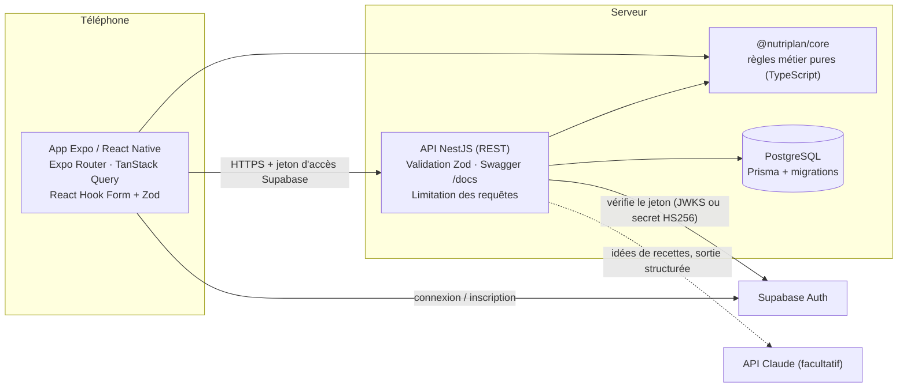
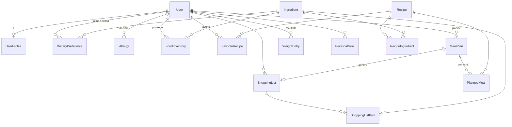

# NutriPlan — Architecture

## 1. Vue d'ensemble



* **`packages/core`** contient toute la logique métier sous forme de fonctions pures, sans base de données
  ni réseau : unités et conversions, portions, contraintes (allergies, régimes, exclusions), générateur de menus,
  liste de courses, budget, estimation énergétique et **schémas Zod partagés**. Elle est utilisée par l'API
  (validation, calculs) et par l'application (validation des formulaires, mise en forme). C'est la partie la
  plus testée.
* **`apps/api`** expose une API REST NestJS. Elle est la seule à accéder à la base de données et la seule à
  connaître les secrets (clé de service Supabase, clé API du modèle de langage).
* **`apps/mobile`** est l'application Expo (iOS, Android, et web pour les tests). Elle ne contient aucun
  secret : seulement l'URL de l'API et la clé **publique** Supabase.

## 2. Organisation des dossiers

```
nutriplan/
├── package.json              # monorepo npm (workspaces)
├── packages/core/            # logique métier partagée + tests (Vitest)
│   ├── src/domain.ts         # vocabulaire : objectifs, 14 allergènes UE, régimes, rayons, repas…
│   ├── src/units.ts          # conversions fiables (masse, volume, pièce)
│   ├── src/recipes.ts        # portions, coût, nutrition par portion
│   ├── src/constraints.ts    # vérification allergies / régimes / exclusions / équipement / temps
│   ├── src/generator.ts      # générateur de menus déterministe
│   ├── src/shopping.ts       # liste de courses, stock, budget
│   ├── src/nutrition.ts      # estimation énergétique indicative
│   └── src/validation.ts     # schémas Zod partagés (formulaires + API)
├── apps/api/                 # NestJS + Prisma
│   ├── prisma/schema.prisma  # schéma de base de données
│   ├── prisma/migrations/    # migrations versionnées
│   ├── prisma/seed.ts        # chargement du catalogue de démonstration
│   ├── (catalogue : packages/core/src/demo — 74 ingrédients, 43 recettes)
│   ├── src/auth/             # vérification des jetons Supabase, garde globale
│   ├── src/me/               # profil, préférences, allergies, stock, export, suppression
│   ├── src/catalog/          # ingrédients, recettes, favoris
│   ├── src/planning/         # génération et modification des plannings
│   ├── src/shopping/         # liste de courses
│   ├── src/progress/         # tableau de bord, suivi, poids, objectifs
│   ├── src/ai/               # idées de recettes par IA (avec repli)
│   ├── src/common/           # erreurs, validation, journalisation, conservation, limitation
│   └── test/                 # tests de bout en bout (PostgreSQL réel)
├── apps/mobile/              # Expo + Expo Router
│   ├── app/                  # écrans (routage par fichiers)
│   │   ├── welcome.tsx, onboarding/, auth/
│   │   ├── (tabs)/           # Accueil, Planning, Recettes, Courses, Suivi
│   │   ├── recipe/[id].tsx, meal/[planId]/[mealId].tsx, ideas.tsx
│   │   └── settings/         # profil, préférences, allergies, budget, placards, confidentialité
│   └── src/
│       ├── theme/tokens.ts   # système de design : couleurs, espacements, typographie, ombres
│       ├── components/       # composants communs (boutons, champs, cartes, états…)
│       ├── features/         # questionnaire (étapes, sections réutilisées dans les paramètres)
│       └── lib/              # client API, Supabase, requêtes TanStack, notifications
└── docs/
```

## 3. Décisions techniques

| Sujet | Décision | Raison |
|---|---|---|
| Logique métier | Package `core` pur et partagé | Une seule implémentation des règles (allergies, portions, budget), testable sans base ni réseau, identique côté app et serveur. |
| Validation | Zod partout (schémas partagés) ; `ZodPipe` côté NestJS | Les mêmes règles et messages en français dans les formulaires et dans l'API. Documentation Swagger générée à partir des schémas (`z.toJSONSchema`). |
| Montants | Entiers en **centimes** | Pas d'erreurs d'arrondi sur les budgets. |
| Quantités | Unité de base par ingrédient (g, ml ou pièce) | Additions fiables ; conversion masse ↔ volume uniquement si la densité est connue, pièce ↔ masse uniquement si le poids unitaire est connu. Sinon, lignes séparées. |
| Générateur de menus | Règles déterministes avec graine | Reproductible, explicable, testable et gratuit. L'IA n'est pas nécessaire pour ce problème de contraintes. |
| IA | Réservée aux « idées avec mes placards » | Usage créatif où elle apporte quelque chose ; sortie structurée, revérifiée, avec repli. |
| Authentification | Supabase Auth côté app ; vérification du JWT côté API (`jose`) | L'API ne fait confiance qu'à un jeton vérifié (signature, expiration, émetteur, audience, rôle). Compatible clés asymétriques (JWKS) et secret historique HS256. |
| Base de données | PostgreSQL + Prisma, identifiant utilisateur = `sub` Supabase | Intégrité référentielle, suppressions en cascade pour le droit à l'effacement. |
| Bibliothèque de composants | Système de design maison (`src/components/ui.tsx`) | Direction artistique précise (sauge, crème, vert foncé), peu de dépendances, accessibilité maîtrisée. |
| Images de recettes | Illustration sobre par catégorie tant qu'aucune photo n'est fournie | Ne pas afficher d'images trompeuses ; `imageUrl` est pris en charge dès qu'une photo est ajoutée (Supabase Storage recommandé). |

## 4. Modèle de données



Le schéma complet est dans [`apps/api/prisma/schema.prisma`](../apps/api/prisma/schema.prisma). Adaptations par rapport au cahier des charges :

* **User** : l'`id` est celui de Supabase Auth (aucun mot de passe stocké par NutriPlan).
* **UserProfile** : ajout de `sex` (facultatif), `mealsPerDay`, `planningDays`, `equipment`, `diets`, `trainingSessionsPerWeek`, `notificationsEnabled`, `displayName`. Le budget est en centimes (`weeklyBudgetCents`), `cookingTimePreference` est un temps maximal en minutes.
* **DietaryPreference** : `preferenceType` vaut `LIKE` ou `DISLIKE` ; `value` référence l'ingrédient (clé étrangère). Les régimes sont dans `UserProfile.diets`, les allergies dans `Allergy`.
* **Ingredient** : `priceEstimate` est décomposé en `priceEstimateCents` pour `priceQuantity` unités, avec `packageSize`, `priceSource` et `priceUpdatedAt` ; ajout des allergènes (`allergens`, `mayContain` pour les traces), des caractéristiques de régime (`dietFlags`), de `gramsPerPiece`, `densityGPerMl`, `isPantryStaple` et `nutritionSource`.
* **Recipe** : `instructions` est une liste d'étapes ; ajout de `category`, `slotKinds`, `equipment`, `tags`, `isDemo`.
* **MealPlan** : ajout du budget de la période, de `feasible`, du rapport de génération (problèmes et suggestions), de la graine et de `archived`.
* **PlannedMeal** : ajout de `completedAt` (repas réalisé).
* **ShoppingListItem** : `ingredientId` facultatif (articles manuels avec `customName`), `category`, `isManual`, `userEdited` (quantité modifiée conservée lors d'un recalcul), `isPantryStaple`.
* Ajout de **WeightEntry** (suivi du poids facultatif) et **PersonalGoal** (objectifs personnels).

Contraintes d'unicité : un profil par utilisateur, une préférence par (utilisateur, ingrédient), une allergie par (utilisateur, allergène), un favori par (utilisateur, recette), un article de stock par (utilisateur, ingrédient), une liste de courses par planning, une pesée par jour. Index sur les clés de recherche (utilisateur, dates, catégories, noms).

Migrations : `20261026140248_init` (schéma) et `20261026150000_enable_rls` (active la sécurité au niveau des lignes sans aucune politique, pour qu'une base hébergée chez Supabase ne soit pas lisible via son API REST automatique avec la clé publique).

## 5. Règles métier

1. **Contraintes strictes** (`core/constraints.ts`) : une recette est exclue si un ingrédient contient un allergène déclaré, appartient à un régime exclu, ou a été refusé par l'utilisateur. Les traces (« peut contenir ») sont exclues pour une allergie sévère **ou de gravité non précisée** (principe de précaution) et signalées pour une intolérance. Un ingrédient inconnu est refusé, car ses allergènes ne peuvent pas être vérifiés. Ces règles s'appliquent à la génération, aux alternatives, au remplacement manuel (refus 422) et aux propositions de l'IA.
2. **Générateur** (`core/generator.ts`) : pour chaque créneau, choix de la recette la mieux notée selon les goûts, les aliments en stock, la réutilisation d'ingrédients (anti-gaspillage), les favoris, le coût par rapport au budget du créneau, l'adéquation énergétique (si estimée) et une forte pénalité de répétition (pas la même recette à moins de 2 jours d'intervalle si possible). Ensuite, **réparation budgétaire** : les repas les plus chers sont remplacés tant que le coût baisse. Si le budget reste dépassé, le plan est marqué **non réalisable**, avec l'écart chiffré et des ajustements proposés. Si aucune recette ne convient, l'API répond 422 avec des pistes (temps, équipement, exclusions).
3. **Portions** : les quantités sont multipliées par `portions voulues / portions de la recette`.
4. **Liste de courses** (`core/shopping.ts`) : regroupement par ingrédient dans l'unité de base, soustraction du stock (après conversion), arrondi lisible (pièces entières à l'achat), classement par rayon. Le **coût d'achat estimé** compte les conditionnements entiers (un paquet de 500 g), sauf pour les produits de placard (sel, huile, épices), comptés au prorata.
5. **Recalcul** : toute modification de recette ou de portions reconstruit la liste de courses dans la même transaction, en conservant les articles manuels, les articles cochés et les quantités modifiées par l'utilisateur.
6. **Prix** : ce sont des estimations de démonstration, non relevées en magasin, modifiables en base et datées (`priceUpdatedAt`). L'interface l'indique sur la liste de courses et les fiches.
7. **Nutrition** : valeurs approximatives pour 100 g (ordre de grandeur Ciqual/ANSES), signalées comme estimations ; les totaux sont marqués « incomplets » si une donnée manque. L'estimation énergétique (Mifflin-St Jeor) est indicative : pas de calcul sans taille et poids, déficit modéré plafonné à 15 % et jamais sous le métabolisme de base ni 1 200 kcal, aucun déficit pour les mineurs ou un IMC bas.

## 6. Sécurité et confidentialité

| Exigence | Mise en œuvre |
|---|---|
| Authentification | Jetons Supabase vérifiés côté serveur : signature (JWKS ou HS256), expiration, émetteur, audience `authenticated`, rôle `authenticated`, sujet UUID. |
| Routes privées | Garde globale : toute route est privée sauf `@Public()` (`/health`, `/ingredients`). Côté app, l'espace à onglets redirige vers l'accueil sans session. |
| Contrôle d'accès | Chaque requête est filtrée par l'utilisateur du jeton (`where: { userId }`, ou via le planning parent). Une ressource d'autrui renvoie 404, sans révéler son existence. Tests dédiés. |
| Validation | Zod sur tous les corps, paramètres et requêtes ; `ParseUUIDPipe` sur les identifiants. |
| Erreurs | Filtre global : format unique `{statusCode, error, message, details?}`, messages en français, aucun détail interne pour les erreurs 500. |
| Limitation des requêtes | 120 requêtes/min par session ; 10/min pour la génération, 5/min pour l'IA, 3/min pour l'export et la suppression. Compté par empreinte du jeton (et non par IP). |
| Journalisation | Méthode, route (identifiants masqués), statut, durée. Ni corps, ni IP, ni e-mail, ni identifiant utilisateur. |
| Secrets | Uniquement dans l'environnement du serveur ; configuration validée au démarrage ; `.env` ignoré par Git ; l'app ne reçoit que des variables publiques. |
| En-têtes HTTP | `helmet` ; CORS fermé par défaut (liste blanche). |
| RGPD | Consentement explicite à l'inscription ; données sensibles facultatives ; export JSON complet ; suppression immédiate de toutes les données (cascade) et du compte d'authentification si la clé de service est configurée ; purge quotidienne des plannings archivés après `RETENTION_MONTHS` (12 par défaut). |
| IA | Clé côté serveur ; envoi limité aux ingrédients autorisés, au type de repas et au souhait éventuel (ni e-mail ni identifiant) ; sortie structurée validée puis revérifiée par les règles d'allergies. |

## 7. Intégration de l'IA

`POST /ai/recipe-ideas` (`apps/api/src/ai/ai.service.ts`) :

1. Construit la liste des ingrédients **déjà filtrés** selon les allergies, régimes et exclusions de l'utilisateur.
2. Appelle Claude (modèle défini par `AI_MODEL`) via le SDK officiel, avec une **sortie structurée** (`output_config.format` + schéma Zod), un effort bas, un délai maximal de 45 s et le repli serveur `fallbacks: "default"` en cas de refus.
3. Revalide la réponse avec Zod, rejette tout ingrédient inconnu ou toute quantité invalide, puis repasse chaque idée dans `checkRecipe`. Une idée non conforme n'est jamais affichée.
4. **Repli** : si la clé est absente, si le service est indisponible ou refuse, ou si aucune idée ne passe les vérifications, on propose les recettes du catalogue qui utilisent le plus le stock de l'utilisateur. La réponse indique toujours sa source (`ai` ou `catalogue`).

## 8. Limites connues et évolutions proposées

* **Catalogue de démonstration** : 43 recettes, prix et valeurs nutritionnelles approximatifs. Avant une commercialisation, il faut importer les valeurs exactes de la table Ciqual, des prix réellement relevés et datés, ainsi que des photos sous licence.
* Le filtrage du catalogue se fait en mémoire, ce qui convient à quelques centaines de recettes. Au-delà, il faudra déplacer les filtres en SQL (coût et compatibilité précalculés).
* Pas encore de mode hors ligne : TanStack Query met les données en cache pendant la session, sans persistance.
* Notifications : rappel quotidien local uniquement (pas de push serveur).
* Le stock n'est pas décrémenté automatiquement quand un repas est réalisé.
* Évolutions possibles : saisonnalité des fruits et légumes, objectifs nutritionnels par repas, partage de liste de courses au sein du foyer, import de recettes personnelles.
